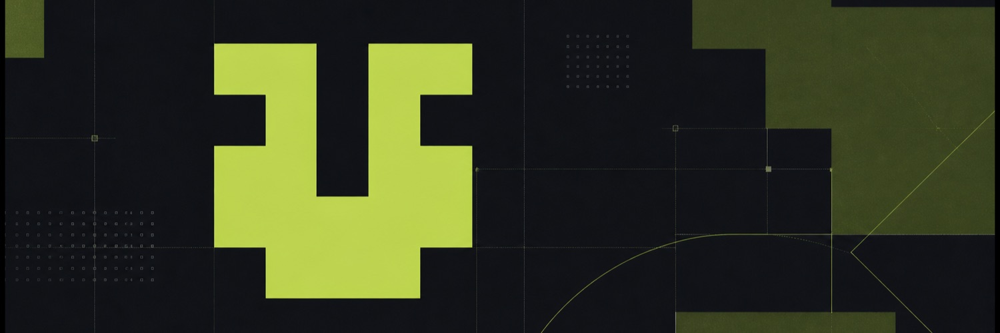

  
    
  
<strong>Practical tools for AI coding and macOS.</strong>

  
<samp>Built with AI. Shaped by everyday use.</samp>

  
Currently at <strong><a href="https://converge.ai/">Converge AI</a></strong>, working on <strong><a href="https://combos.converge.ai/">Combos</a></strong>.

  
<samp>
    <a href="https://timmyagentic.si">Website</a> ·
    <a href="https://quota-monitor.timmyagentic.si">Quota Monitor</a> ·
    <a href="https://github.com/timmyagentic/cc-connect-next">cc-connect-next</a> ·
    <a href="https://github.com/timmyagentic?tab=repositories">Projects</a> ·
    <a href="mailto:tzhou125@connect.hkust-gz.edu.cn">Email</a>
  </samp>

## Building

I turn problems I run into every day into tools I can use. Codex and Claude Code help me build; I take the work from finding the problem through testing, shipping, and maintenance.

### AI & Agents

- [**Quota Monitor**](https://github.com/timmyagentic/quota-monitor) — Codex and Claude Code quotas, reset times, and usage trends in your Mac menu bar. Built with SwiftUI. 
  [Website](https://quota-monitor.timmyagentic.si) · [Download](https://quota-monitor.timmyagentic.si/download)
- [**cc-connect-next**](https://github.com/timmyagentic/cc-connect-next) — Drive local coding agents from chat, with Feishu/Lark streaming cards and mid-turn steering on supported backends. An independent successor to CC Connect. 
  [Website](https://cc-connect-next.timmyagentic.si) · [Install](https://github.com/timmyagentic/cc-connect-next/blob/main/INSTALL.md) · [Feishu setup](https://github.com/timmyagentic/cc-connect-next/blob/main/docs/feishu.md)
- [**Emomo**](https://github.com/timmyagentic/emomo) — Meme search for AI agents, with a CLI and reusable skills. 
  [Website](https://emomo.timmyagentic.si) · [Repository](https://github.com/timmyagentic/emomo)
- [**Awesome Agent App Features**](https://github.com/timmyagentic/awesome-agent-app-features) — Reusable feedback and safe update components for agent-powered apps, designed for coding agents to integrate into existing projects. 
  [Integration guide](https://github.com/timmyagentic/awesome-agent-app-features/blob/main/docs/agent-integration.md) · [Releases](https://github.com/timmyagentic/awesome-agent-app-features/releases)

### Devices & Productivity

- [**AgenticFan**](https://github.com/timmyagentic/agentic-fan) — Native macOS temperature monitoring and time-limited fan control for Apple silicon, with a menu bar app and a JSON CLI for agents. 
  [Website](https://agenticfan.timmyagentic.si) · [Install](https://github.com/timmyagentic/agentic-fan/blob/codex/apple-silicon-dmg/INSTALL.md)
- [**SMB Share**](https://github.com/timmyagentic/smb-share) — A lightweight Android share target that sends files directly to a Mac or SMB2/3 share over your local network, with no desktop companion or cloud relay. 
  [Website](https://smb.timmyagentic.si) · [Download](https://github.com/timmyagentic/smb-share/releases/latest)
- [**MMF Gesture Fix**](https://github.com/timmyagentic/mmf-gesture-fix) — A macOS 27 companion for supported Mac Mouse Fix versions that preserves continuous gestures and corrects conflicting horizontal release velocity. 
  [Compatibility](https://github.com/timmyagentic/mmf-gesture-fix#compatibility) · [Download](https://github.com/timmyagentic/mmf-gesture-fix/releases/latest)

### Networking

- [**Route Monitor**](https://github.com/timmyagentic/route-monitor) — Local routing diagnostics for Mihomo and ShellCrash, with connection history, checks across direct and proxy paths, and opt-in routing corrections backed by evidence. 
  [Website](https://route-monitor.timmyagentic.si) · [Download](https://github.com/timmyagentic/route-monitor/releases/latest)
- [**Clash Verge Monitor**](https://github.com/timmyagentic/clash-verge-monitor) — Local traffic accounting for Clash Verge and Mihomo, with per-app usage, SQLite history, and read-only audits for agents. 
  [Website](https://clash-verge-monitor.timmyagentic.si) · [Releases](https://github.com/timmyagentic/clash-verge-monitor/releases)

## Earlier work

[**MMF27 Dock Swipe Fix**](https://github.com/timmyagentic/mac-mouse-fix-macos-27-fix) · [**AI Coding Prompt**](https://github.com/timmyagentic/ai-coding-prompt) · [**CodexSpeed**](https://github.com/timmyagentic/codexspeed) · [**Typeless++**](https://github.com/timmyagentic/typeless-plusplus)

---

Have feedback? Open an issue in the relevant project, or reach me by [email](mailto:tzhou125@connect.hkust-gz.edu.cn). English and Chinese welcome.

  <picture>
    <source media="(prefers-color-scheme: dark)" srcset="https://raw.githubusercontent.com/timmyagentic/timmyagentic/output/snake-dark.svg">
    
  </picture>

